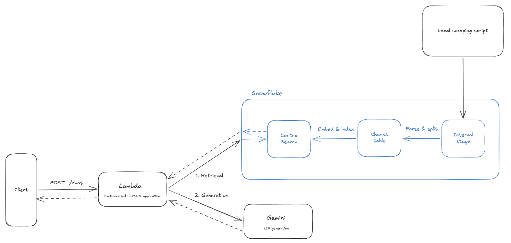
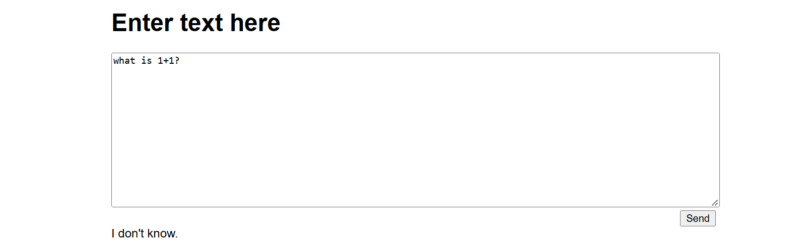

# RAG evaluation

A lightweight evaluation pipeline for a simple, mock RAG application.

## RAG pipeline

A high-level architecture diagram:

For a more technical overview, the app is deployed on AWS and Snowflake via CI/CD tools like Terraform and GitHub Actions. To simplify the infrastructure, Lambda gates every request - I've bundled the frontend asset and the FastAPI backend in a single Docker image which Lambda runs at invocation. When the user hits the `chat/` endpoint with a `POST`, it first embeds the prompt and searches for relavent chunks (retrieval), then the result is fed into the context of the LLM generator along with the original prompt (generation).

## Evaluation pipeline

A high-level architecture diagram:

This project focuses on metrics that quantify RAG quality - other metrics like latency, cost, scalability, and consistency are out of scope for now. These metrics can be broken down into either retrieval metrics and generation metrics. 

Retrieval metrics are evaluated with plain functions:

- context precision
- context recall
- mean reciprocal rank

Generation metrics are evaluated with Ragas:

- faithfulness
- answer relevance
- answer correctness

Experiment runs are tracked and visualised through MLflow.

## Working snapshot

